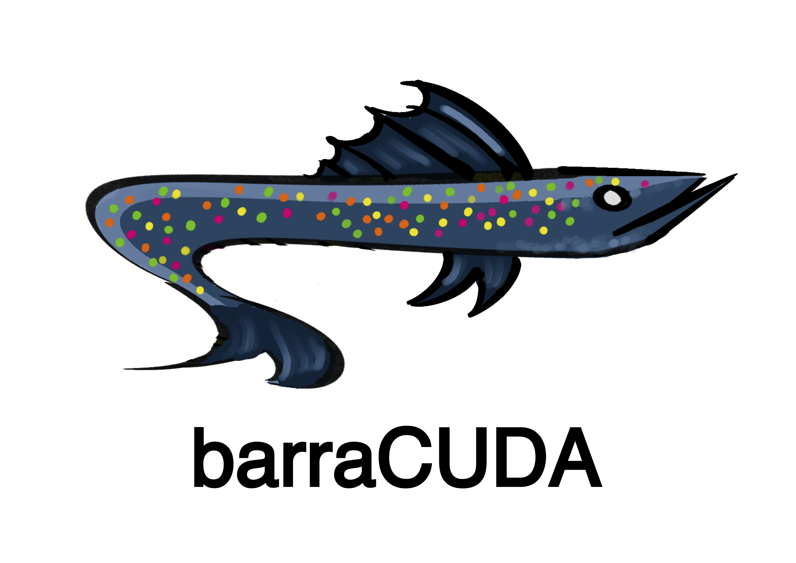

# barraCUDA

A full suite of tools for MERFISH processing: CZI/PSF conversion to OME-Zarr,
GPU image processing, spot decoding, Cellpose segmentation, 3D segmentation, and SpatialData export.

## Installation

Use Python 3.12 for the full workflow. The base package requires Python 3.12 or
newer; the published u-Segment3D package currently requires Python below 3.13.
To install:
```bash
git clone https://github.com/mikejdeines/barraCUDA
cd barraCUDA
python3.12 -m venv .venv
source .venv/bin/activate
python -m pip install --upgrade pip
python -m pip install .
```

### NVIDIA GPU support

On a supported NVIDIA CUDA 12 system:

```bash
python -m pip install '.[cuda12]'
```

The image-processing filters, registration, and deconvolution require CuPy and
cuCIM. Installing the base package alone does not enable those operations.
CUDA packages require compatible NVIDIA hardware and drivers, therefore this package does not run
on macOS. Follow the [CuPy installation guide](https://docs.cupy.dev/en/stable/install.html)
and [RAPIDS system requirements](https://docs.rapids.ai/install/) for your host.

Optional KvikIO support can be installed with `python -m pip install '.[cuda12,kvikio]'`.
The code falls back to ordinary Zarr I/O when `kvikio.zarr.GDSStore` is unavailable.
Optional cuDF and cuML acceleration is detected if those packages are already
installed, but installing them is highly recommended.

### Cellpose segmentation

```bash
python -m pip install '.[cellpose]'
```

This extra installs Cellpose and PyTorch. Choose a PyTorch build compatible with
your GPU using the [PyTorch installation instructions](https://pytorch.org/get-started/locally/).
The environment's `torch==2.11.0+cu126` is a CUDA 12.8 build, and the package
metadata leaves that build selection to the target environment.

**Segmentation also requires a compatible installation of `uSegment3D`.** The
published [u-Segment3D](https://pypi.org/project/u-Segment3D/) dependency metadata
requires `numpy<2.0`, `cellpose<4.0`, and `pyarrow<21`, conflicting with the supplied
environment and this code's Cellpose-SAM workflow. It is therefore not included
in an install extra. Resolve this with a compatible upstream release or a
validated local build before calling `run_cellpose_on_ngff`; the `cellpose` extra
alone is insufficient. Do not bypass dependency checks to force these releases
into the same environment. We recommend 

## Usage

Import functions from their modules; there is no command-line entry point.

```python
from barracuda.image_conversion import convert_czi_to_ngff

convert_czi_to_ngff("sample.czi", "sample.zarr")
```

Conversion replaces an existing output .zarr store.

| Module | Purpose |
| --- | --- |
| `barracuda.image_conversion` | Convert CZI images and PSF TIFFs; extract DAPI |
| `barracuda.image_processing` | Normalize, register, filter, and deconvolve image stacks |
| `barracuda.decode_spots` | Decode MERFISH spots, filter calls, and generate QC plots |
| `barracuda.run_cellpose` | Segment nuclei with Cellpose-SAM and u-Segment3D |
| `barracuda.create_spatialdata` | Assemble transcript and nucleus data into SpatialData |